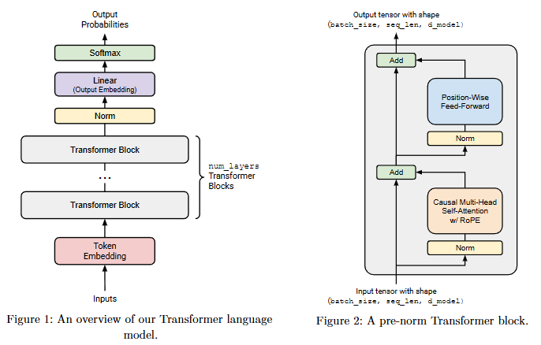
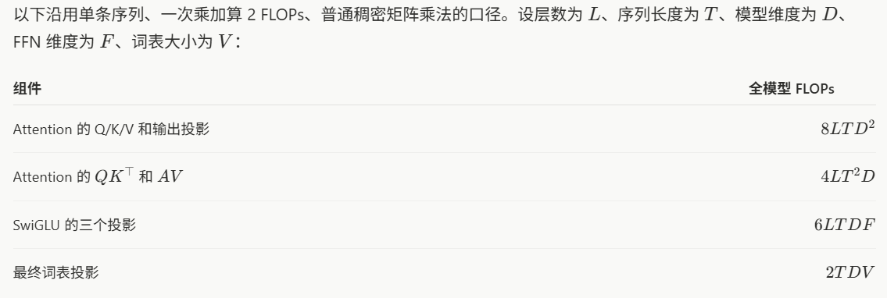
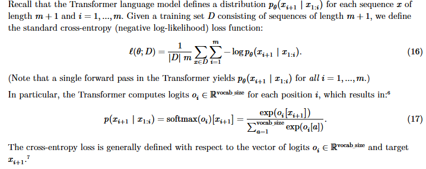
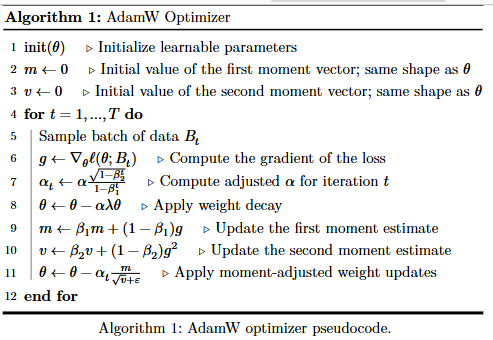

# 1. Overview

1. BPE tokenizer
2. Transformer LM
3. cross-entropy loss funciton and AdamW optimizer
4. training loop with support for serilizing and loading model and optimizer state

Except for `torch.nn.Parameter`, container classes in `torch.nn`(e.g., `Module`, `ModuleList`, `Sequential`) and `torch.optim.Optimizer` base class, all other definitions in `torch.nn` and `torch.optim` are not allowed to be used.

# 2. BPE tokenizer

## 2.1 Unicode and UTF

Unicode is a text encoding standard that maps characters to integer code points.

UTF - Unicode Transformation Format

UTF-8共五类byte格式：
| 首字节前缀 | 字符占几字节 | 格式 |
|---|---|---|
| `0` | 1 字节 | `0xxxxxxx` |
| `110` | 2 字节 | `110xxxxx 10xxxxxx` |
| `1110` | 3 字节 | `1110xxxx 10xxxxxx 10xxxxxx` |
| `11110` | 4 字节 | `11110xxx 10xxxxxx 10xxxxxx 10xxxxxx` |
| `10` | 续字节 | `10xxxxxx` |

## 2.2 Training

### 1. Vocabulary initialization

按byte大小初始化一个大小为256的vocabulary

### 2. Pre-tokenization

```python
>>> PAT = r"""'(?:[sdmt]|ll|ve|re)| ?\p{L}+| ?\p{N}+| ?[^\s\p{L}\p{N}]+|\s+(?!\S)|\s+"""
>>> import regex as re
>>> re.findall(PAT, "some text that i'll pre-tokenize")
['some', ' text', ' that', ' i', "'ll", ' pre', '-', 'tokenize']
```

### 3. Compute BPE merges

将出现次数最多的字典序较大的byte pair合并成一个token

```python
>>> max([("A", "B"), ("A", "C"), ("B", "ZZ"), ("BA", "A")])
('BA', 'A')
# ('BA', 'A') -> 'BAA'
```
### Special tokens

`<|endoftext|>`等特殊token不参与分词

## 2.3 Tokenizer

Encode：特殊 token 直接映射，普通文本先预分词，再按 merge 优先级做 BPE 合并，最后查表转成 id。

Decode：id 查表得到 bytes，拼接后 UTF-8 解码成文本。

# 3. Transformer LM Architecture

## 3.1 Transformer LM



### Token Embeddings

Embedding Layer: 
(batch_size, sequence_length) -> (batch_size, sequence_length, d_model)

### Pre-norm Tranformer Block

Decoder-only Transformer LM由`num_layers`个相同的Transformer blocks组成。每个Transformer block接受`(batch_size, 
sequence_length, d_model)`，输出`(batch_size, 
sequence_length, d_model)`。每个block通过self-attention聚合信息，然后通过feed-forward layers非线性变换信息。

## 3.2  Remark: Batching, Einsum and Efficient Computation

einops.einsum:
```py
import torch
from einops import rearrange, einsum

## Basic implementation
Y = D @ A.T
# Hard to tell the input and output shapes and what they mean.
# What shapes can D and A have, and do any of these have unexpected behavior?

## Einsum is self-documenting and robust
#                          D                A     ->          Y
Y = einsum(D, A, "batch sequence d_in, d_out d_in -> batch sequence d_out")

## Or, a batched version where D can have any leading dimensions but A is constrained.
Y = einsum(D, A, "... d_in, d_out d_in -> ... d_out")
```

einops.rearrange:
```py
images = torch.randn(64, 128, 128, 3)  # (batch, height, width, channel)
dim_by = torch.linspace(start=0.0, end=1.0, steps=10)

## Reshape and multiply
dim_value = rearrange(dim_by,    "dim_value              -> 1 dim_value 1 1 1")
images_rearr = rearrange(images, "b height width channel -> b 1 height width channel")
dimmed_images = images_rearr * dim_value

## Or in one go:
dimmed_images = einsum(
    images, dim_by,
    "batch height width channel, dim_value -> batch dim_value height width channel"
)
```

```py
channels_last = torch.randn(64, 32, 32, 3)  # (batch, height, width, channel)
B = torch.randn(32*32, 32*32)
## Rearrange an image tensor for mixing across all pixels
channels_last_flat = channels_last.view(
    -1, channels_last.size(1) * channels_last.size(2), channels_last.size(3)
)
channels_first_flat = channels_last_flat.transpose(1, 2)
channels_first_flat_transformed = channels_first_flat @ B.T
channels_last_flat_transformed = channels_first_flat_transformed.transpose(1, 2)
channels_last_transformed = channels_last_flat_transformed.view(*channels_last.shape)

height = width = 32
## Rearrange replaces clunky torch view + transpose
channels_first = rearrange(
    channels_last,
    "batch height width channel -> batch channel (height width)"
)
channels_first_transformed = einsum(
    channels_first, B,
    "batch channel pixel_in, pixel_out pixel_in -> batch channel pixel_out"
)
channels_last_transformed = rearrange(
    channels_first_transformed,
    "batch channel (height width) -> batch height width channel",
    height=height, width=width
)
```

## 3.3  Basic Building Blocks: Linear and Embedding Modules

### Parameter Initialization

- Linear weights: 𝒩︀(𝜇 = 0, 𝜎^2 = 2/(𝑑_in+𝑑_out)) truncated at [−3𝜎, 3𝜎].
- Embedding: 𝒩︀(𝜇 = 0, 𝜎^2 = 1) truncated at [−3, 3]
- RMSNorm: 𝟙

初始化runcated normal weights: `torch.nn.init.trunc_normal_`

### Linear Module

𝑦 = 𝑊𝑥
x: (..., d_in)
W: (d_out, d_in)
y: (..., d_out)

### Embedding Module

y = weight[token_ids]

W: (vocab_size, d_model)
token_ids: (...)
y: (..., d_model)

## 3.3 Pre-Norm Transform Block

Two sub-layers: a multi-head self-attention mechanism and a position-wise feed-forward network.

Post-Norm:
```py
x = LayerNorm(x + SelfAttention(x))
x = LayerNorm(x + FFN(x))
```

Pre-Norm:
```py
x = x + SelfAttention(LayerNorm(x))
x = x + FFN(LayerNorm(x))
```

### RMS Layer Normalization

RMSNorm(𝑎_𝑖) = 𝑎_𝑖/RMS(𝑎)*𝑔_𝑖
RMS(𝑎) = sqrt(1/𝑑_model*∑𝑑_model to 𝑖=1 𝑎_𝑖^2 + 𝜀)
g_i是可学习参数，𝜀是超参数，通常为1e-5

### Position-Wise Feed-Forward Network

FFN(𝑥) = SwiGLU(𝑥, 𝑊1, 𝑊2, 𝑊3) = 𝑊2(SiLU(𝑊1𝑥) ⊙ 𝑊3𝑥)

### Relative Positional Embeddings

RoPE: Rotary Positional Embedding

### Scaled Dot-Product Attention

数值稳定softmax

Attention(𝑄, 𝐾, 𝑉) = softmax(𝑄𝐾^𝑇/√𝑑𝑘)𝑉 
𝑄 ∈ ℝ^𝑛×𝑑_𝑘 , 𝐾 ∈ ℝ^𝑚×𝑑_𝑘 , and 𝑉 ∈ ℝ^𝑚×𝑑_𝑣

Masking: 𝑀 ∈ {True, False}^𝑛×𝑚

每个人（query）拿自己的问题，去和所有名牌（key）比对，得到关注分数。 → S = QK^T
分数归一化成注意力权重。 → A = softmax(S)
按权重把所有人的信息（value）加权汇总，得到自己的新理解。 → O = A @ V

所以：
S 是“谁该关注谁”的矩阵，大小 seq × seq。
A 是归一化后的关注度。
O 是每个 token 融合上下文后的新表示。

### Causal Multi-Head Self-Attention

MultiHeadSelfAttention(𝑥) = 𝑊_𝑂MultiHead(𝑊_𝑄𝑥, 𝑊_𝐾𝑥, 𝑊_𝑉𝑥)

## 3.4 The Full Transformer LM

Rule: Given 𝐴 ∈ ℝ^𝑚×𝑛 and 𝐵 ∈ ℝ^𝑛×𝑝, the matrix-matrix product 𝐴𝐵 requires 2𝑚𝑛𝑝 FLOPs.



# 4. Training a Transformer LM

## 4.1 Cross-entropy loss



## 4.2 The SGD Optimizer

随机挑选样本计算梯度

## 4.3 AdamW

Besides the learning rate 𝛼, AdamW has a pair of hyperparameters (𝛽1, 𝛽2) that control the updates to the moment estimates, and a weight decay rate 𝜆. 



## 4.4 Learning rate scheduling

cosine annealing schedule 余弦退火
```py
def get_lr_cosine_schedule(
    it: int,
    max_learning_rate: float,
    min_learning_rate: float,
    warmup_iters: int,
    cosine_cycle_iters: int,
) -> float:
    if it < warmup_iters:
        return max_learning_rate * it / warmup_iters
    
    if it <= cosine_cycle_iters:
        progress = (it - warmup_iters) / (cosine_cycle_iters - warmup_iters)
        return min_learning_rate + 0.5 * (
            1 + math.cos(math.pi * progress)
        ) * (max_learning_rate - min_learning_rate)

    return min_learning_rate
```

## 4.5 Gradient clipping

算所有梯度合在一起的 L2 范数，超过阈值时按同一个比例缩小。

# 5 Training loop

## 5.1 Data Loader

A data loader turns this into a stream of batches, where each batch consists of 𝐵 sequences of length 𝑚, paired with the corresponding next tokens, also with length 𝑚. For example, for 𝐵 = 1, 𝑚 = 3, ([𝑥2, 𝑥3, 𝑥4], [𝑥3, 𝑥4, 𝑥5]) would be one potential batch.

## 5.2 Checkpointing

## 5.3 Training loop

# 6 Generating text

Decoder tricks:
1. Temperature: softmax(𝑣, 𝜏)𝑖 = exp(𝑣_𝑖/𝜏)/∑vocab_size to 𝑗=1 exp(𝑣_𝑗/𝜏).
2. top-p/nucleus: 从小到大累积概率，到达p后移除之前的词


# Profiling

**cProfile：Python 自带，无需安装。** 它记录函数调用次数和耗时。[官方说明](https://docs.python.org/3.12/library/profile.html)

```bash
uv run --no-sync python -m cProfile -o /tmp/bpe.prof \
  -m pytest tests/test_train_bpe.py::test_train_bpe -q
```

查看结果：

```bash
uv run --no-sync python -m pstats /tmp/bpe.prof
```

进入交互界面后输入：

```text
sort cumulative
stats 20
sort time
stats 20
quit
```

重点理解三列：

| 列 | 含义 |
| --- | --- |
| `ncalls` | 调用次数 |
| `tottime` | 函数自身耗时，不含子调用 |
| `cumtime` | 函数及其子调用的总耗时 |

先按 `cumulative` 找耗时入口，再按 `time` 找自身开销大的函数。pytest 启动和模块导入也会被记录，注意关注你自己的实现。

**py-spy：采样分析，适合较长任务。** 可以生成火焰图，也可以实时查看热点。[官方说明](https://github.com/benfred/py-spy#usage)

用 `uvx` 运行工具，无需改作业依赖：

```bash
uvx py-spy record -o /tmp/bpe.svg -- \
  .venv/bin/python -m pytest \
  tests/test_train_bpe.py::test_train_bpe -q
```

完成后用浏览器打开 `/tmp/bpe.svg`。如果任务太短，样本可能不足，换成有代表性的较长运行。

实时查看则使用：

```bash
uvx py-spy top -- .venv/bin/python -m pytest \
  tests/test_train_bpe.py::test_train_bpe -q
```
