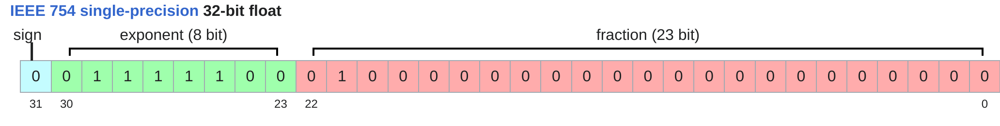
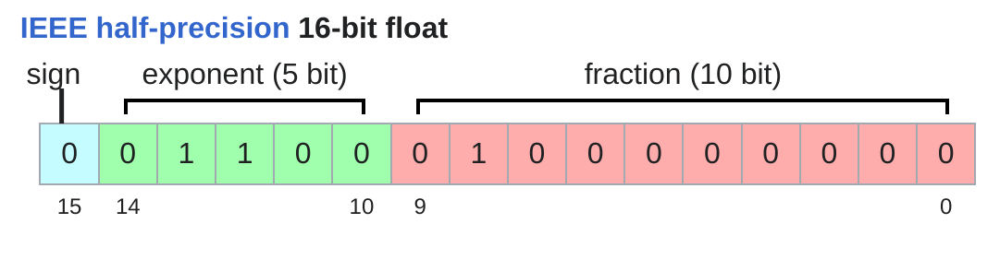
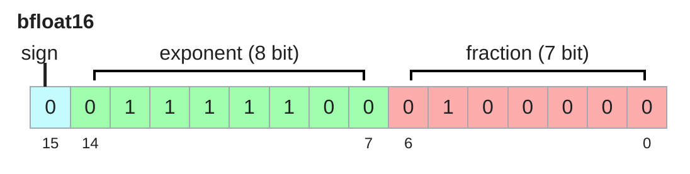
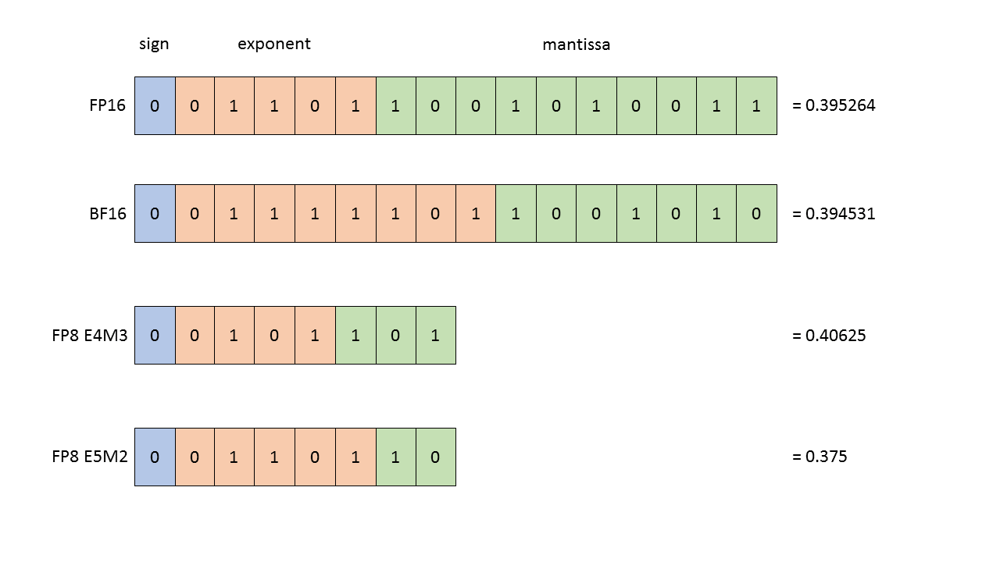

# Lecture 2: PyTorch(einops) and resource accounting

## Tensors basics

```python
x = torch.zeros(4)        # rank 1 tensor (vector) 
x = torch.zeros(4, 8)     # rank 2 tensor (matrix) 
x = torch.zeros(4, 8, 2)  # rank 3 tensor
B = 32   # Batch size
S = 16   # Sequence length
H = 16   # Number of heads
D = 64   # Hidden dimension per head
x = torch.zeros(B, S, H, D) 
```

## Tensors memory

Elements of tensors are floating point numbers.

### fp32



```python
x = torch.zeros(4, 8)  
assert x.dtype == torch.float32  # Default type
assert x.numel() == 4 * 8
assert x.element_size() == 4  # Float is 4 bytes
assert get_memory_usage(x) == 4 * 8 * 4  # 128 bytes
```

### fp16



```python
x = torch.zeros(4, 8, dtype=torch.float16)  
assert x.element_size() == 2
x = torch.tensor([1e-8], dtype=torch.float16)  
assert x == 0  # Underflow!
```

### bp16



```python
x = torch.tensor([1e-8], dtype=torch.bfloat16)  
assert x != 0  # No underflow!
```

### fp8



### fp4

Values: -6, -4, -3, -2, -1.5, -1.0, -0.5, 0.0, 0.5, 1.0, 1.5, 2, 3, 4, 6


## Tensors on gpus

By default, tensors are stored in CPU memory.
```py
x = torch.zeros(32, 32)
assert x.device == torch.device("cpu")
device = cuda_if_available()  
x = x.to(device)
with torch.device(device):
    x = torch.zeros(32, 32)
    assert x.device == device
```

## Tensor einops

einsum:
```py
x = torch.ones(3, 4)  # seq1 hidden 
y = torch.ones(4, 3)  # hidden seq2 
# Old way
z = x @ y   # seq1 seq2 
# New (einops) way
z = einsum(x, y, "seq1 hidden, hidden seq2 -> seq1 seq2")  

x = torch.ones(2, 3, 4)  # batch seq1 hidden 
y = torch.ones(2, 3, 4)  # batch seq2 hidden 
# Old way
z = x @ y.transpose(-2, -1)  # batch seq1 seq2  
# New (einops) way
z = einsum(x, y, "batch seq1 hidden, batch seq2 hidden -> batch seq1 seq2")
# Or can use `...` to represent broadcasting over any number of dimensions
z = einsum(x, y, "... seq1 hidden, ... seq2 hidden -> ... seq1 seq2")  
```

reduce:
```py
x = torch.ones(2, 3, 4)  # batch seq hidden 
# Old way
y = x.sum(dim=-1)  
# New (einops) way
y = reduce(x, "... hidden -> ...", "sum") 
```

rearrange:
```py
x = torch.ones(3, 8)  # seq total_hidden
w = torch.ones(4, 4)  # hidden1 hidden2 
# Break up `total_hidden` into two dimensions (`heads` and `hidden1`
x = rearrange(x, "... (heads hidden1) -> ... heads hidden1", heads=2)  
# Perform the transformation by `w`
x = einsum(x, w, "... hidden1, hidden1 hidden2 -> ... hidden2")  
# Combine `heads` and `hidden2` back together
x = rearrange(x, "... heads hidden2 -> ... (heads hidden2)")
```

## Tensor operations flops

A floating-point operation (FLOP) is a basic operation like addition (x + y) or multiplication (x y).

- FLOPs: floating-point operations (measure of computation done)   
- FLOP/s: floating-point operations per second (also written as FLOPS), which is used to measure the speed of hardware.

MFU = (actual FLOP/s) / (promised FLOP/s)
Usually, MFU of ≥ 0.5 is quite good!

## Arithmetic intensity

1. Accelerator speed (FLOP/s)
2. Memory bandwidth (bytes/s)
   
- Memory-bound: communication time > computation time  
- Compute-bound: computation time > communication time

Accelerator intensity: how much work can the accelerator do per byte transferred?
Arithmetic intensity: how much actual work per byte for this workload?
- Memory-bound: arithmetic intensity < accelerator intensity 
- Compute-bound: arithmetic intensity > accelerator intensity

## Gradient basics

Linear model: y = 0.5 (x * w - 5)^2

Forward pass: compute loss
```py
x = torch.tensor([1., 2, 3])
w = torch.tensor([1., 1, 1], requires_grad=True)  # Want gradient
pred_y = x @ w
loss = 0.5 * (pred_y - 5).pow(2)
```

Backward pass: compute gradients
```py
loss.backward()
assert torch.equal(w.grad, torch.tensor([1, 2, 3]))  
```

## Gradient flops

```py
B = 1024  # Number of points
D = 256   # Dimension

x = torch.ones(B, D, device=cuda_if_available())
w1 = torch.randn(D, D, device=cuda_if_available(), requires_grad=True)
w2 = torch.randn(D, D, device=cuda_if_available(), requires_grad=True)

# Forward pass
h1 = einsum(x, w1, "batch in, in out -> batch out")  # x 
h2 = einsum(h1, w2, "batch in, in out -> batch out")  # h1 
loss = (h2.mean() - 0)**2  # Regress everything to 0 (arbitrary)

# Backward pass
h1.retain_grad()  # For debugging
h2.retain_grad()  # For debugging
loss.backward()
```


On the second layer (h2 = h1 @ w2):
Forward pass: Recall the number of forward FLOPs:  
```py
num_forward_flops = 2 * B * D * D
``` 
Backward pass: How many FLOPs is running the backward pass?
We need to compute:
    - h1.grad = d loss / d h1
    - w2.grad = d loss / d w2
```py
h1_grad = einsum(h2.grad, w2, "batch out, in out -> batch in")
assert torch.allclose(h1.grad, h1_grad)
w2_grad = einsum(h2.grad, h1, "batch out, batch in -> in out")
assert torch.allclose(w2.grad, w2_grad)
num_backward_flops = (2 * B * D * D) + (2 * B * D * D)  
```

Putting it together:
- Forward pass: 2 (# data points) (# parameters) FLOPs
- Backward pass: 4 (# data points) (# parameters) FLOPs
- Total: 6 (# data points) (# parameters) FLOPs

## Optimizer
- momentum = SGD + exponential averaging of grad
- AdaGrad = SGD + averaging by grad^2
- RMSProp = AdaGrad but with exponential averaging of grad^2
- Adam = RMSProp + momentum

## Activation checkpointing

For training, we need to store the activations of all layers
For inference, we don't compute gradients, so we only need to store the current layer's activations.

## Summary
- Everything is operations on tensors (parameters, gradients, activations, optimizer states, data)
- einops: better way to think about tensor operations
- 6 (# data points) (# parameters) FLOPs per training step
- Arithmetic intensity / roofline analysis: compute-bound or memory-bound?
- Matrix multiplications are compute-bound, elementwise operations are memory-bound
- Gradient accumulation, activation checkpointing: reduce memory to use bigger batch size